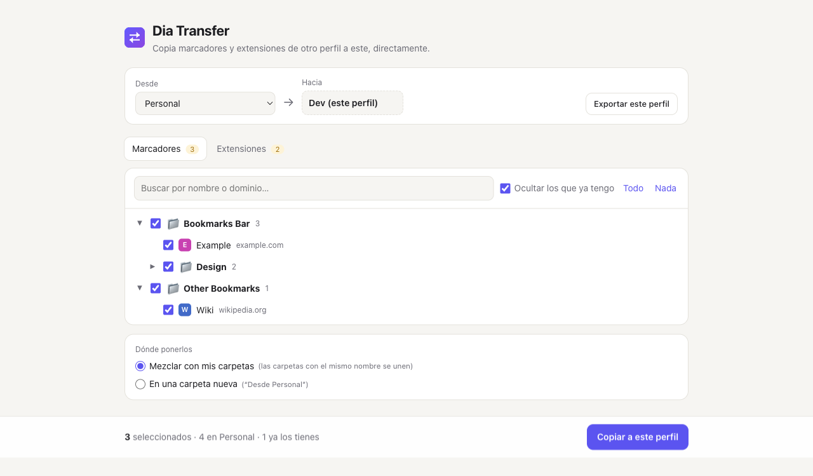

# Dia Transfer

Copy **bookmarks** and **extensions** from one browser profile to another, directly — no exporting, no importing HTML files.
Made for [Dia](https://www.diabrowser.com/), works with any Chromium browser on macOS (Chrome, Arc, Brave, Edge, Vivaldi, Chromium).



[Español más abajo ↓](#español)

## What it does

- **Bookmarks:** pick what to copy from any other profile (whole folders or single links). Links you already have are hidden. Copies straight into the current profile, merging folders with the same name or into a new folder. One-click **Undo**.
- **Extensions:** shows which extensions the other profile has and this one doesn't. Browsers don't allow silent installs, so each one opens in the Chrome Web Store of this profile and you just click *Add*. The list updates as you install.
- **Export / import a file:** save a profile to a `.json` file to move it to another Mac.

## Install

```sh
git clone https://github.com/atormo/dia-transfer.git
cd dia-transfer
./install.sh
```

Or just double-click **`Instalar Dia Transfer.command`** (if you downloaded the ZIP: right-click → Open the first time).

Then, in the profile you want to copy **into** (only once):

1. Open `chrome://extensions`
2. Turn on **Developer mode**
3. Click **Load unpacked**, press Cmd+Shift+G, paste (the path is already copied) and open:
   `~/Library/Application Support/DiaTransfer/extension`
4. Click the Dia Transfer icon in the toolbar. That's it — from now on, it's one click.

Repeat steps 1–3 in any other profile you want to copy into. Requires Python 3 (`xcode-select --install` if you don't have it).

To remove it: `./uninstall.sh` and remove the extension.

## How it works

A browser extension can't see other profiles, so Dia Transfer has two parts:

| Part | Does | Access |
| --- | --- | --- |
| `extension/` | UI. Creates bookmarks with the official `chrome.bookmarks` API in the profile it runs in. | Writes only to its own profile, via the browser API |
| `host/host.py` | Small [native messaging](https://developer.chrome.com/docs/extensions/develop/concepts/native-messaging) helper the browser starts on demand. Lists profiles and reads their `Bookmarks` file and `Extensions` folder. | **Read-only**. No network. Only answers this extension. |

Nothing touches the browser's files directly, so it's safe with the browser open and with Dia's encrypted bookmark storage and sync.

**Privacy:** everything stays on your Mac. No servers, no analytics.

## Limits

- macOS only for now.
- Extension *data* (logins, settings) can't be copied — the browser keeps it per profile. Extensions with an account sync back when you sign in.
- Settings like search engines or Dia Skills are stored encrypted and aren't exposed by any API.

## Development

```sh
python3 -m unittest discover tests   # host tests
```

Edit files in `extension/`, then hit reload on `chrome://extensions`. The extension has a fixed ID (`igninmfomapgemelieneadccdejgifkl`, from the `key` in `manifest.json`) so the helper recognizes it wherever the folder lives.

Not affiliated with The Browser Company. MIT license.

---

## Español

Copia **marcadores** y **extensiones** de un perfil del navegador a otro, directamente, sin exportar ni importar archivos.

### Instalar (una vez)

1. Descarga el proyecto (botón verde **Code → Download ZIP**) y descomprímelo.
2. Doble clic en **`Instalar Dia Transfer.command`** (la primera vez: clic derecho → Abrir).
3. En Dia, en el perfil **al que quieres copiar**: abre `chrome://extensions`, activa **Modo de desarrollador**, pulsa **Cargar descomprimida**, luego Cmd+Shift+G, pega (Cmd+V) y Abrir.

### Usar (siempre)

Pulsa el icono 🔁 de Dia Transfer en la barra → elige qué copiar → **Copiar a este perfil**.

### Qué puedes hacer

- **Marcadores:** elige el perfil de origen, marca carpetas o enlaces (los que ya tienes salen ocultos) y pulsa **Copiar a este perfil**. Puedes mezclarlos con tus carpetas o meterlos en una carpeta nueva. Si te equivocas, **Deshacer último**.
- **Extensiones:** ves cuáles te faltan y cada una se abre en la Chrome Web Store de este perfil para pulsar *Añadir*.
- **Exportar este perfil:** guarda un `.json` para llevarlo a otro Mac e importarlo desde el selector “Desde”.

Todo se queda en tu Mac: el ayudante local solo lee, no se conecta a internet y solo responde a esta extensión.
